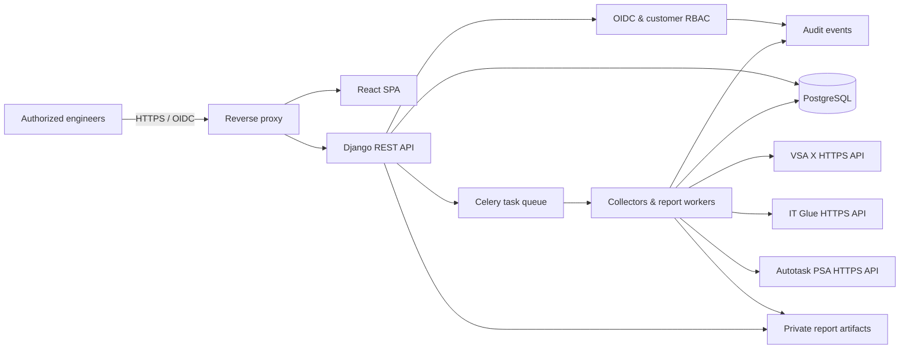
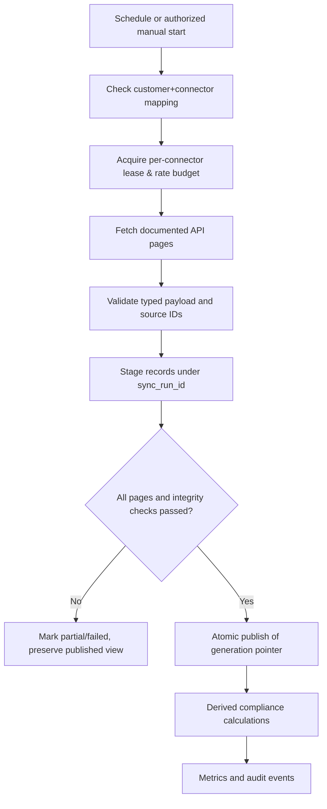

# Architecture — Odyssey Kaseya Analytics & Reporting Portal

**Status:** Proposed production target; not yet deployed.  
**Architecture style:** Modular monolith + asynchronous workers.  
**Principle:** Reporting/analytics layer; vendor products remain systems of record.

## 1. Context and boundaries

The portal reads operational data from one or more VSA X instances, IT Glue regions/accounts, and Autotask PSA zones/accounts. An integration instance may cover multiple customers, so credentials **never imply** that users may view all source records. Mapping each vendor organization to an explicitly approved internal customer is mandatory.

The portal must **not** implement agent check-in, patch orchestration, asset lifecycle ownership, or ticket processing as replacement core systems. It must not share the same database or login sessions as any unrelated Odyssey application.

## 2. Logical component diagram

Trust boundaries:
1. User/browser → portal (authenticated, CSRF/session hardened).
2. API → PostgreSQL and job queue (internal service network, least privilege).
3. Collectors → external/vendor endpoints (approved outgoing destinations only).
4. Portal → report artifacts (short-lived signed access or authenticated streaming; no public bucket).
5. Authentication → IdP (OIDC; MFA by policy).

## 3. Modules and responsibilities

| Django module | Responsibilities | Read/write boundary |
|---|---|---|
| `accounts` | OIDC, session, users, roles, customer grants | Internal only |
| `customers` | Customer metadata, approved mappings, retention rules | Internal only |
| `integrations` | Adapter registry, credentials references, jobs, checkpoints | GET only to vendors |
| `inventory` | VSA asset normalized inventory and snapshots | Internal normalized tables |
| `software` | Catalog, aliases, editions/channels, version comparator and classifications | Internal catalog editable by authorized roles |
| `patching` | Available/installed OS update observations, denominators and coverage | Read-only source data |
| `itglue` | Configuration records, source links, reconciliation evidence | GET only to IT Glue |
| `autotask` | Companies, tickets, status/priority history | GET only to Autotask |
| `reporting` | Aggregate queries, saved views, artifacts, scheduler | Internal only |
| `audit` | User, connector, export and administrative audit | Append-only |

Django REST API owns all business logic. React never calls vendor APIs. A `CustomerScope` context is resolved server-side and passed to every query, report and job.

## 4. Sync pipeline and correctness

**Every dataset stores:** `integration_instance_id`, `customer_id`, vendor external ID, `observed_at`, `collected_at`, `sync_run_id`, `published_generation_id`, and classification provenance. Batch deletion from vendors must be distinguished from a failed/incomplete sync; mark records inactive only after a successful, complete inventory with documented tombstone rules.

Use adapter-independent stage → validate → promote logic. Incremental sync is optional and enabled only after the vendor supports a reliable cursor/watermark and deletion behavior; periodic full reconciliation remains required.

For large VSA estates, `GET /api/v3/assets` is paginated using `$top` (maximum 100) and `$skip`; check HTTP 429 and `Retry-After`, budget both full and detail API calls, and prefer summary/detail strategies that avoid excessive per-device calls. **Never** make one external API request per rendered table row.

## 5. Data freshness and observable state

- A connector status is one of `idle`, `queued`, `running`, `partial`, `failed`, `completed`, `disabled`.
- Report datasets have `as_of` timestamp and a source sync status per integration.
- Data older than an administrator-configured threshold is **stale**; dashboards display warning but do not silently drop it.
- Completeness = expected in-scope assets with valid observations / actual eligible assets, when denominator exists. Do not guess unknown population.
- Application-version classification uses reviewed `catalog_revision_id` so historical results can be reproduced.
- OS patch data may be absent from certain device/platform types: record `not_supported` / `not_collected`, not `compliant`.

## 6. Frontend experience

Main navigation: Dashboard, Customers, Assets, Software, Windows Updates, IT Glue, Autotask PSA, Reports, Administration. Customer selector persists within an authorized session (server checks it on each request). Asset table supports saved views, server-side filtering and pagination. Device detail tabs show overview, inventory, installed software, OS updates, source mappings, and observation history.

Every chart/table has visible source, `as_of`, customer scope, denominator, and states for loading/empty/error/stale. UI should favor compact, information-dense engineering screens over oversized tiles.

## 7. API strategy (portal internal API)

All routes use `/api/v1`. Examples (design targets, not existing endpoints):

| Route | Permission | Behavior |
|---|---|---|
| `GET /customers/` | Scoped | Assigned customers only |
| `GET /customers/{id}/assets/` | Customer read | Search, filter, sort, paginate |
| `GET /assets/{id}/` | Customer read | Customer resolved from DB, never from unsafe supplied claim |
| `GET /customers/{id}/software-compliance/` | Customer read | Snapshot-safe analysis |
| `GET /customers/{id}/os-updates/` | Customer read | Actual reported OS updates |
| `POST /customers/{id}/sync-runs/` | Engineer/admin policy | Enqueue vendor **read-only** job |
| `GET /customers/{id}/sync-runs/` | Customer read | Status, progress, errors, freshness |
| `POST /reports/` | Customer report permission | Generate asynchronously |
| `GET /reports/{id}/download/` | Artifact scope check | Reauthorize on each download |
| `GET /admin/integrations/` | Global admin | No credential return |

Use cursor/keyset pagination where appropriate; stable order for exports. Validate all filter keys against allowlists. API must return standardized structured errors; don't reveal vendor auth details to ordinary users.

## 8. Scaling and reliability

Initial target: >=50 customer organizations, >=100k current assets, millions of observations, configurable retention. Targets are design goals, not benchmark claims. PostgreSQL partial/covering indexes, bounded querysets, bulk inserts, background exports, configurable Celery queues and rate budgets. Dedicated worker queues: `sync_vsa`, `sync_itglue`, `sync_psa`, `reports`, `maintenance`. Parallelism **per integration instance** is capped.

High availability is a later environment-specific requirement; do not claim production HA merely because Compose restarts containers. Backups must include database, report-artifact encryption keys, configuration metadata, and reproducible catalog revisions. Validate isolated restore.

## 9. Error and edge cases

- Vendor 401/403 → stop sync, alert admin, preserve published data; no credential dump.
- Vendor 429 → honor `Retry-After`, checkpoint and reschedule.
- Vendor 5xx/timeouts → bounded exponential backoff; no endless task retry.
- Source organization unmapped → quarantine record, alert reviewer, never assign to default customer.
- Duplicate/ambiguous device IDs → quarantine collision and preserve source lineage.
- Unsupported software version → `unknown`, record comparison reason and evidence.
- Lost worker during publication → transaction rollback and retry with idempotent run key.
- Deleted account or revoked membership → immediately remove artifact access, invalidate sessions when policy requires.

## 10. Cross-system correlation

Maintain explicit, source-specific identity links with `match_method`, `confidence`, `reviewed_by`, `reviewed_at`, and `status`. Serial number + source context may be strong evidence; hostname alone is weak and nonunique. Never auto-merge IT Glue configurations or PSA tickets by fuzzy name matching.

## 11. Beyond v1

Vulnerability correlation, approved write workflows and an MCP adapter are **separate change-controlled enhancements**, not prerequisites. If added, use the portal's customer-scoped application services rather than bypassing its authorization and audit layers.
