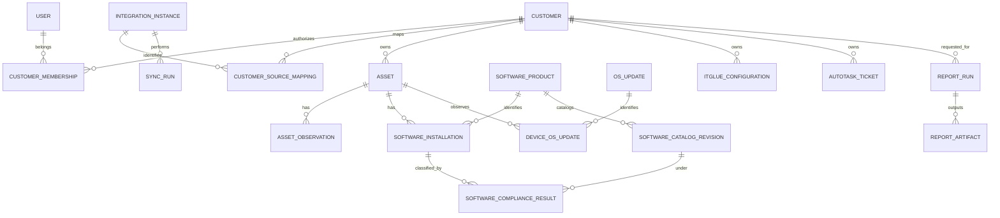

# Database design and migrations

**Database:** PostgreSQL 16+ via Django ORM.  
**Rule:** Every customer-owned row has a non-null `customer_id`, except approved global reference catalog tables. `integration_instance_id` is necessary to disambiguate vendor IDs across instances.

## 1. Entity model

## 2. Field conventions

- IDs: application-side UUID primary keys; vendor external IDs stored as text to avoid accidental cross-vendor coercion.
- All timestamps: `timestamptz` UTC; capture source `observed_at` separately from portal `collected_at` and `created_at`.
- Soft delete/inactive for source data; do not erase historical snapshots on ordinary re-sync.
- Add `created_at`, `updated_at`, and meaningful `source_payload_schema_version` where helpful.
- Store only allowlisted normalized fields and optional **sanitized** raw payload excerpts with short retention; never persist vendor secrets or IT Glue passwords.

## 3. Table specification

### Accounts and customers

| Table | Key columns and constraints |
|---|---|
| `users` | `id`, `oidc_sub` unique per issuer, `email`, `display_name`, `is_active`; optional local bootstrap auth only |
| `roles` | `key` unique: `super_admin`, `admin`, `engineer`, `viewer`; explicit permission capabilities |
| `customers` | `id`, `code` unique, `name`, `status`, `data_region`, `retention_policy_id` |
| `customer_memberships` | `customer_id`, `user_id`, `role_id`, `is_active`; unique `(customer_id,user_id)` |
| `integration_instances` | `id`, `provider` (`vsa_x`,`itglue`,`autotask`), `base_url`, `region`, `credential_ref`, `enabled`, `verify_tls`, `max_rps`; `verify_tls` must be true in prod |
| `customer_source_mappings` | `customer_id`, `integration_instance_id`, `external_org_id`, `mapping_status`, `reviewed_by`, `reviewed_at`; unique `(integration_instance_id, external_org_id)` for active mappings; cannot map one source org to two customers |

### Synchronization

| Table | Key columns and constraints |
|---|---|
| `sync_schedules` | `integration_instance_id`, optional `customer_id`, `dataset`, `cron_or_interval`, `enabled` |
| `sync_runs` | `id`, `integration_instance_id`, `customer_id`, `dataset`, `state`, `started_at`, `ended_at`, `last_page`, `fetched_count`, `accepted_count`, `quarantined_count`, `error_code`, `generation_id`; idempotency key |
| `sync_checkpoints` | `sync_run_id`, `page_token`, `cursor`, `last_external_id`, `updated_at`; secrets forbidden |
| `published_generations` | `integration_instance_id`, `customer_id`, `dataset`, `generation_id`, `published_at`, `row_count`, `validation_hash`; unique current generation pointer per scope |
| `sync_quarantines` | `sync_run_id`, `external_id`, `reason`, safe redacted field snapshot, `resolved_at` |

### Assets and observations

| Table | Key columns and constraints |
|---|---|
| `assets` | `id`, `customer_id`, `integration_instance_id`, `external_id`, `hostname`, `device_type`, `os_name`, `site_external_id`, `group_name`, `last_seen_online`, `active`; unique `(integration_instance_id, external_id)` |
| `asset_identifiers` | `asset_id`, `kind`, `value_normalized`, `source`, `observed_at`; nonunique across customers unless verified |
| `asset_network_interfaces` | `asset_id`, MAC/IP/interface, `collected_at`, `generation_id` |
| `asset_observations` | `asset_id`, `generation_id`, `observed_at`, `collected_at`, `agent_version`, selected hardware/status, source_ref; unique `(asset_id, generation_id)` |

### Installed software and catalog

| Table | Key columns and constraints |
|---|---|
| `software_products` | `id`, `vendor`, `product`, `edition`, `platform`, `channel`, `architecture`, `normalization_state` |
| `software_aliases` | `product_id`, `publisher_pattern`, `name_pattern`, `match_type`, `review_status`, `reviewed_by`; never allow unreviewed alias to silently drive classification |
| `software_installations` | `customer_id`, `asset_id`, `product_id` nullable, `raw_name`, `raw_publisher`, `raw_version`, `normalized_version`, `generation_id`, `observed_at`, `collected_at`; key includes source installation discriminator or row hash to preserve distinct installs |
| `software_catalog_revisions` | `product_id`, `reference_version`, `version_scheme`, `channel`, `architecture`, `edition`, `vendor_url`, `source_type`, `source_checked_at`, `effective_at`, `reviewed_by`, `state`; immutable published revisions |
| `software_compliance_results` | `installation_id`, `catalog_revision_id` nullable, `generation_id`, `state`, `reason_code`, `algorithm_version`, `evaluated_at`; history preserved |
| `software_exceptions` | `customer_id`, `product_id`, optional `asset_id`, `reason`, `approver`, `approved_at`, `expires_at`, `status`; exclusions never alter underlying observed version |

### OS patch reporting

| Table | Key columns and constraints |
|---|---|
| `os_updates` | normalized `update_id`, `revision`, `kb`, `title`, optional severity, vendor/source |
| `device_os_updates` | `customer_id`, `asset_id`, `os_update_id`, `state` (`available`,`installed`), `generation_id`, source fields, `observed_at` |
| `patch_observations` | `asset_id`, `generation_id`, `scan_status`, `available_critical_count`, `available_important_count`, `source_collected_at`, `unavailable_reason` |
| `patch_compliance_snapshots` | `customer_id`, `generation_id`, `policy_version`, `eligible_count`, `compliant_count`, `unknown_count`, `excluded_count`, `calculated_at` |

### IT Glue and PSA

| Table | Key columns and constraints |
|---|---|
| `itglue_configurations` | `customer_id`, `integration_instance_id`, `external_id`, `name`, `hostname`, `serial_number`, `asset_tag`, `type`, `status`, `source_link`, `generation_id` |
| `asset_configuration_links` | `customer_id`, `asset_id`, `configuration_id`, `match_method`, `confidence`, `status`, `reviewed_by`; unique reviewed active link where one-to-one is appropriate |
| `autotask_tickets` | `customer_id`, `integration_instance_id`, `external_id`, `company_external_id`, `title`, `status`, `priority`, `created_at_source`, `updated_at_source`, `closed_at_source`, `generation_id`; sanitize descriptions |
| `ticket_asset_links` | `customer_id`, `ticket_id`, `asset_id`, `match_method`, `status`, `reviewed_by` |

### Reporting and audit

| Table | Key columns and constraints |
|---|---|
| `saved_views` | `customer_id`, `owner_id`, optional share scope, `filter_json`, `columns_json`; validate against allowlists |
| `report_templates` | `slug`, `version`, `schema`, `enabled`; no executable user-supplied code |
| `report_definitions` | `customer_id`, `owner_id`, `template_id`, `filters`, `column_ids`, `permissions` |
| `report_schedules` | `report_definition_id`, `frequency`, `timezone`, `recipient_refs`, `enabled` |
| `report_runs` | `customer_id`, `requested_by`, `state`, `as_of_generation_ids`, `filters_hash`, `row_count`, `started_at`, `completed_at`, `error_code` |
| `report_artifacts` | `report_run_id`, `storage_key`, `format`, `sha256`, `bytes`, `expires_at`, `encryption_key_ref` |
| `audit_events` | `id`, `actor_id`, `action`, `customer_id`, `target_type`, `target_id`, `outcome`, `request_id`, `created_at`, source IP (policy-controlled) |

## 4. Indexing and constraints

Implement indexes for:
- `assets(customer_id, hostname)` and `assets(customer_id, last_seen_online)`.
- `assets(integration_instance_id, external_id)` unique.
- `software_installations(customer_id, generation_id, product_id)` and `(asset_id, generation_id)`.
- `software_compliance_results(generation_id, state, catalog_revision_id)`.
- `device_os_updates(customer_id, generation_id, state, os_update_id)`.
- `autotask_tickets(customer_id, status, updated_at_source)`.
- `sync_runs(integration_instance_id, customer_id, dataset, started_at DESC)`.
- `audit_events(customer_id, created_at DESC)`; archive/partition if necessary.

Every record mapping to a customer must satisfy consistent customer relationships; validate in service layer and add DB constraints/triggers where ORM constraints are insufficient. Avoid relying on filters applied only in serializers or the UI.

## 5. Historical snapshots and publication

For source datasets use `generation_id` and versioned observations. Collect into an unpublished generation. After all pages are fetched and data quality checks pass, atomically update `published_generations` in a DB transaction. Reports pin every dataset generation used. For time-based trends, aggregate daily/weekly snapshots with explicit retained source baseline.

If a sync fails: retain previous generation as current, surface its `as_of` and `stale` status, and keep a failed run record. A successful sync may mark absent assets inactive only after complete pagination and reconciliation.

## 6. Data retention and privacy

Define customer-specific policy for active inventory, historical observations, audit, and artifacts. Default values are **not contractual requirements** and must be approved before production. Purge by background job with audit trail; backups follow separate retention rules and secure erasure process.

## 7. Migration plan

1. Foundational auth/customer/connector tables.
2. Synchronization generation and run/checkpoint tables.
3. Assets and software catalog/observations.
4. OS updates and compliance.
5. Reporting definitions/artifacts.
6. IT Glue/PSA tables and correlation links.
7. Data indexes/partitioning optimized after benchmark evidence.

Use reversible migrations where feasible, avoid destructive schema changes during deploy, and test migration forward/backward on a disposable PostgreSQL database. Never use SQLite-only tests as evidence of PostgreSQL correctness.
